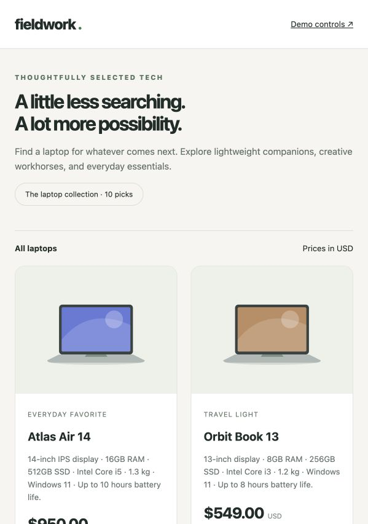

# Shopping Assistant

A local MCP server and plugin skill that turn confirmed shopping requirements into matching product URLs. ChatGPT constructs the filter; the backend extracts listing evidence, checks prices in code, and uses OpenAI Decisions (`gpt-6-luna`) for semantic criteria.



## Architecture

`ChatGPT + skill → filter_products MCP → allowed catalog → exact price checks → Decisions semantic checks → ranked product links`

The API key stays on the backend. Price-only requests skip OpenAI entirely.

## Setup

Requires Python 3.11 or newer. From this project directory:

```sh
python3 -m venv .venv
.venv/bin/python -m pip install -e .
```

Copy `.env.example` to `.env` if you do not already have one (`cp .env.example .env`). Keep existing credentials when upgrading. The required variable for semantic filtering is `OPENAI_API_KEY`; `.env.example` documents optional limits. `.env` is ignored by Git and is never bundled into the plugin. Shell environment values take precedence. Price-only filtering needs no API key.

To recreate the exact tested dependency environment, use `requirements.lock.txt` before installing the project with `--no-deps -e .`. The lock was generated with Python 3.14 on macOS; other platforms may need to resolve their own dependencies from `pyproject.toml`.

## Run a search without ChatGPT

```sh
.venv/bin/python -m shopping_assistant.cli examples/price-only.json
.venv/bin/python -m shopping_assistant.cli examples/laptops.json
```

The second command sends paid API requests to OpenAI for up to the configured product cap. A small live check:

```sh
SHOPPING_MAX_PRODUCTS=3 .venv/bin/python -m shopping_assistant.cli examples/live-smoke.json
```

JSON goes to stdout. Exit code 2 means invalid setup/request or extraction failure; code 1 means at least one product ended in the error group. Results containing errors in optional preferences can remain matches, with `complete: false` and a warning.

## Run the MCP server

For an MCP client that launches a subprocess:

```sh
.venv/bin/python -m shopping_assistant.server
```

For a local Streamable HTTP client:

```sh
.venv/bin/python -m shopping_assistant.server --transport http --port 8000
```

The endpoint is `http://127.0.0.1:8000/mcp`. It is deliberately loopback-only and unauthenticated for local development. The server does not start automatically on installation. For the personal hackathon demo, an HTTPS tunnel can expose this server without authentication. Anyone who knows that URL can trigger requests billed to the server owner. Per-search caps do not impose a total spending quota; stop the tunnel after the demo.

For a stdio client, use the absolute path to this checkout's `.venv/bin/python`, arguments `-m shopping_assistant.server`, and this project directory as `cwd`. The `.env` is resolved relative to the source checkout, not the client's working directory.

## Tool contract

`filter_products(url, filter, result_limit=10)` accepts the shape illustrated in `examples/laptops.json`:

- `url`: HTTPS listing URL from the allowlist below, or the exact local demo listing when demo mode is enabled; no query or fragment.
- `filter.price`: up to two `{operator, amount, currency}` conditions. Operators: `lt`, `lte`, `gt`, `gte`; currency: `USD`. Amounts support two decimal places. Comparisons use decimal arithmetic. Under $800 excludes exactly $800.
- `filter.requirements`: up to eight mandatory natural-language criteria (all must match).
- `filter.preferences`: up to four optional criteria, equally weighted for ranking.
- `result_limit`: 1–50, applied separately to each returned group. It does not change the evaluation cap.

Returns `matches`, `uncertain`, `errors`, and a sample of `excluded`, including original product descriptions, URLs, listed prices, and each criterion's classification/source. The model does not produce free-form rationales or verified evidence excerpts. Describe its judgments honestly using the accompanying source text.

`counts` covers all checked products, even when the returned groups are truncated. `products_found` counts unique valid products extracted; `products_checked` counts products processed (including failed evaluations), `products_not_checked` reports the cap, and `extraction_skipped` reports malformed cards. `complete` means no cap, extraction skips, or criterion errors; missing product information can still remain. `results_truncated` separately indicates omitted results. `fetched_at` is UTC.

Definite mandatory failures exclude a product. Unknown mandatory facts produce `uncertain`; mandatory API failures produce `errors`. Preferences cannot override a mandatory failure. With only preferences, at least one supported preference is required for the matches group; other products remain uncertain. Any preference API error is disclosed even when mandatory criteria pass.

## Supported pages and limits

- https://webscraper.io/test-sites/e-commerce/allinone/computers/laptops
- https://webscraper.io/test-sites/e-commerce/allinone/computers/tablets
- https://webscraper.io/test-sites/e-commerce/allinone/phones/touch
- http://127.0.0.1:8765/laptops (local Fieldwork shop; requires `SHOPPING_DEMO_ENABLED=1`, see below)

These are demo catalogs, not current purchasable offers. Only the supplied listing is fetched. No product-detail browsing, pagination, images, other stores, currency conversion, taxes/shipping calculation, persistent cache, watchlists, or purchases. Unsupported URLs and redirects are rejected. The fetched body is capped at 3 MB.

Defaults: first 30 products, 5 simultaneous evaluations, 30-second request timeout, 180-second evaluation deadline measured from search start. A semantic search sends one Decisions request per product that passes exact checks, with all semantic questions grouped together. One SDK retry is allowed; cancelled or failed evaluations stay explicit. Repeating a search repeats the API calls. These are per-search limits, not production account quotas.

## Plugin and skill

`plugins/shopping-assistant/` contains the portable `plugin.json`, local `mcp.json`, and `skills/shopping-assistant/SKILL.md`. The skill guides confirmation, tool arguments, evidence-aware presentation, and refinements. MCP server instructions provide a short version to clients that only connect the tool.

The package points at the local HTTP endpoint; run it before connecting a supported local client. It is not installed, published, or registered in ChatGPT automatically. ChatGPT cloud cannot reach your machine's loopback URL. For a personal cloud demo, supply a reachable HTTPS endpoint and select No authentication during registration. Follow [plugin release instructions](docs/plugin-release.md). A skill file alone does not create a server connection. No custom visual extension or Chrome extension is needed for this MVP.

## Tests

```sh
.venv/bin/python -m unittest discover -s tests -v
```

The offline suite uses a saved public listing and mocked provider responses. It covers extraction, unsafe URLs, redirects, missing data, exact price boundaries, invalid filters, mandatory/preference behavior, provider failures/refusals, search deadlines, result caps, and MCP discovery/structured output. It does not require `.env` or contact external services. Demo integration tests bind an ephemeral loopback port.

Try the skill's sample requests after connecting ChatGPT. Live tool selection and presentation are not validated by local tests.

Verified locally on October 10, 2026: all 22 tests passed; editable installation and dependency checks passed; both stdio and HTTP MCP tool discovery passed. Live extraction found 117 laptop products. A price-only run checked 30 products (14 below $400), and a three-product Decisions smoke test returned three RAM matches with preference ranking and no API errors. Both capped runs correctly reported partial coverage. These checks used small samples, not an accuracy benchmark for arbitrary prompts.

## Reference documentation

- [Decisions API](https://developers.openai.com/api/docs/guides/decisions)
- [Plugin packaging](https://developers.openai.com/plugins/build/plugins)
- [FastMCP tools](https://gofastmcp.com/servers/tools)

The fixture `tests/fixtures/laptops.html` was retrieved from the public Web Scraper laptop demo on October 10, 2026 and is retained solely for reproducible extraction tests.

## Local demo shop (editable prices)

The checkout includes **Fieldwork**, a fictional ten-laptop shop with local SVG illustrations,
product pages, a price editor, and reset. It uses Python's standard library; no extra install.

Start the shop in one terminal:

```sh
.venv/bin/python -m shopping_assistant.demo_shop
```

Open http://127.0.0.1:8765/laptops and http://127.0.0.1:8765/admin.
Use the exact `127.0.0.1` address (not `localhost`). Prices persist in
`demo_shop/prices.local.json`; the reset button restores `demo_shop/products.json`.
This is a local-only demo with no checkout or payments.

Start the MCP server in another terminal with demo access enabled:

```sh
SHOPPING_DEMO_ENABLED=1 .venv/bin/python -m shopping_assistant.server --transport http --port 8000
```

Alternatively add `SHOPPING_DEMO_ENABLED=1` to the checkout's `.env` and restart the MCP
server. Only the exact listing `http://127.0.0.1:8765/laptops` is additionally permitted;
other local addresses remain rejected. All catalog requests fetch fresh HTML.

### Repeatable demonstration

1. Reset prices in the editor.
2. Run `SHOPPING_DEMO_ENABLED=1 .venv/bin/python -m shopping_assistant.cli examples/demo-shop.json`.
   Three products are under $800; Atlas Air 14 is excluded at $950.
3. Change Atlas Air 14 to $750 and save. Refresh the storefront to see the change.
4. Repeat the same command. Four products now match, including Atlas Air 14 at $750.
5. Reset to repeat the demo. No API requests are made by this price-only example.

For the intended semantic demonstration, use `examples/demo-shop-laptops.json` instead
(requires the existing OpenAI key and sends paid semantic requests). At starting prices,
none satisfy both the budget and 16GB RAM; after the edit Atlas Air 14 should qualify.
AI judgments still use the engine's existing uncertainty/error handling.

Once the plugin is connected to a local task accessible to your dot, request:
“Search http://127.0.0.1:8765/laptops for laptops under $800 with at least 16GB RAM and
SSD storage. Check again in five minutes with the same criteria using filter_products;
notify me about newly matching products with their prices and links.”
Confirm the dot saved the follow-up. Keep the shop, MCP server, and connected computer
running. Scheduling is managed by the dot, not by this website. Cloud-only access to
this loopback endpoint is not configured by this demo.

## Contributing and publishing

See [CONTRIBUTING.md](CONTRIBUTING.md) for local checks and
[personal GitHub instructions](docs/personal-github.md) for publishing without
using a work SSH identity. GitHub Actions runs tests without API credentials.
The Python dependency lock records the tested environment; the application is
intended to run from an editable source checkout (including `demo_shop/` assets).

The optional, incomplete `demo-video/` authoring workspace is excluded from Git.
Generated plugin archives belong in `dist/` and are also excluded. No live tunnel
URL or account-specific plugin ID is required in committed configuration.

## License

Original project code is MIT licensed; see [LICENSE](LICENSE) and
[third-party notices](THIRD_PARTY_NOTICES.md) for the test fixture.
